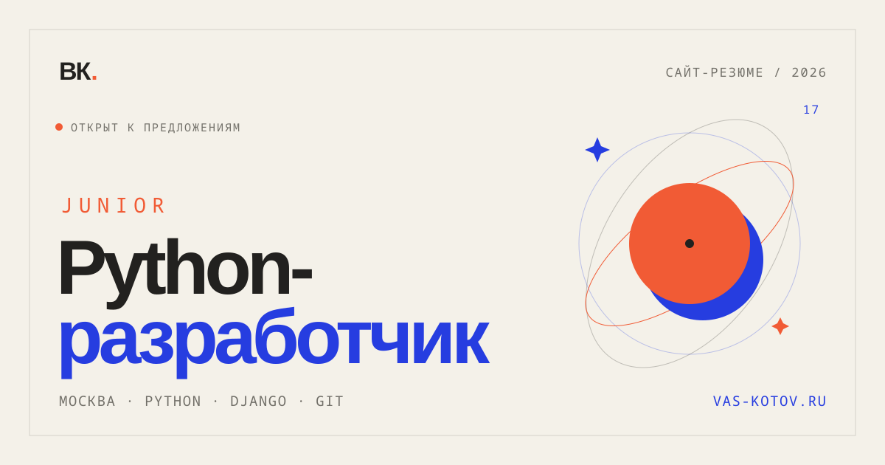

# Василий Котов — сайт-резюме

Персональный сайт-резюме Junior Python/Django-разработчика.

[**Открыть сайт →**](https://vas-kotov.ru/)




## О проекте

Одностраничный сайт с резюме: первый экран, рассказ о себе, навыки, проект,
опыт вне IT и контакты. Вёрстка написана с нуля на HTML и CSS, без UI-фреймворков.

Что реализовано:

- адаптивная вёрстка для мобильных и десктопа;
- семантическая разметка и доступная навигация;
- SEO-мета-теги, Open Graph, JSON-LD и favicon;
- отдельная OG-картинка для превью в мессенджерах;
- тесты главной страницы и CI на GitHub Actions;
- настройки через переменные окружения, без секретов в коде.

## Стек

- Python 3.11+
- Django 5.2 LTS
- HTML5, CSS3, Google Fonts (Manrope, DM Mono)
- SQLite для локальной разработки
- MySQL + `mysqlclient` для production
- Apache + `mod_wsgi` на shared-хостинге

## Структура

```text
.
├── default/                     # настройки проекта
│   ├── settings.py              # конфигурация через env
│   ├── urls.py
│   ├── wsgi.py                  # точка входа WSGI
│   └── asgi.py
├── vas_kotov_app/
│   ├── static/
│   │   ├── css/site.css         # стили сайта
│   │   └── img/                 # favicon и OG-превью
│   ├── templates/home.html      # контент страницы
│   ├── tests.py                 # тесты главной
│   ├── urls.py
│   ├── views.py
│   └── apps.py
├── public_html/
│   ├── .htaccess                # пример конфигурации Apache
│   └── cgi-bin/                 # сюда кладётся WSGI entry point на сервере
├── .github/workflows/ci.yml
├── .env.example
├── manage.py
├── requirements.txt
└── requirements-prod.txt
```

`public_html/static/` — сгенерированная папка для `collectstatic`. В git она не попадает.

## Локальный запуск

Нужен Python 3.11 или новее.

```bash
git clone https://github.com/VANL1/vas-kotov.git
cd vas-kotov

python -m venv venv
source venv/bin/activate        # Windows: venv\Scripts\activate

pip install -r requirements.txt

python manage.py migrate
python manage.py runserver
```

Сайт будет доступен по адресу <http://127.0.0.1:8000/>.

Для локальной разработки переменные окружения не обязательны: по умолчанию
используются `DEBUG=1`, SQLite и dev-ключ. Для production их нужно задать явно.

## Переменные окружения

Скопируйте `.env.example` в `.env` и загрузите переменные в окружение.
Django не читает `.env` автоматически — например:

```bash
set -a
source .env
set +a
```

| Переменная | По умолчанию | Назначение |
|---|---|---|
| `DJANGO_SECRET_KEY` | dev-ключ | Секретный ключ. Обязателен при `DJANGO_DEBUG=0` |
| `DJANGO_DEBUG` | `1` | `1` — разработка, `0` — production |
| `DJANGO_ALLOWED_HOSTS` | `localhost,127.0.0.1` | Домены через запятую |
| `DJANGO_CSRF_TRUSTED_ORIGINS` | пусто | Например, `https://vas-kotov.ru` |
| `DJANGO_DB_ENGINE` | `sqlite` | `sqlite` или `mysql` |
| `DJANGO_DB_NAME` | — | Имя базы MySQL |
| `DJANGO_DB_USER` | — | Пользователь MySQL |
| `DJANGO_DB_PASSWORD` | — | Пароль MySQL |
| `DJANGO_DB_HOST` | — | Хост MySQL (если не сокет) |
| `DJANGO_DB_PORT` | — | Порт MySQL |
| `DJANGO_DB_SOCKET` | — | Unix-сокет MySQL |

Пример для production:

```bash
export DJANGO_DEBUG=0
export DJANGO_SECRET_KEY="$(python -c 'import secrets; print(secrets.token_urlsafe(50))')"
export DJANGO_ALLOWED_HOSTS="vas-kotov.ru,www.vas-kotov.ru"
export DJANGO_CSRF_TRUSTED_ORIGINS="https://vas-kotov.ru"

export DJANGO_DB_ENGINE=mysql
export DJANGO_DB_NAME=your_database
export DJANGO_DB_USER=your_database_user
export DJANGO_DB_PASSWORD=...
export DJANGO_DB_SOCKET=/path/to/mysql.sock
```

Для MySQL установите production-зависимости:

```bash
pip install -r requirements-prod.txt
```

Для сборки `mysqlclient` на Debian/Ubuntu нужны `default-libmysqlclient-dev`,
`build-essential` и `pkg-config`. Если MySQL локально не нужен, достаточно
`requirements.txt`.

## Статика и деплой

Собрать статику в `public_html/static/`:

```bash
python manage.py collectstatic --noinput
```

На shared-хостинге проект работает через Apache + `mod_wsgi`.
Файл `public_html/.htaccess` уже лежит в репозитории. На сервере создайте
точку входа `public_html/cgi-bin/wsgi.py`, например символической ссылкой:

```bash
ln -s "$PWD/default/wsgi.py" "$PWD/public_html/cgi-bin/wsgi.py"
```

`default/wsgi.py` сам добавляет корень проекта (и `venv/`, если он есть)
в `sys.path` и корректно работает как через symlink, так и напрямую.
После изменения настроек или Python-кода перезапустите WSGI-приложение
в панели хостинга.

## Тесты

```bash
python manage.py test
```

CI запускает `manage.py check` и тесты на Python 3.11 при каждом push
и pull request.

## Контент

- тексты и разметка — `vas_kotov_app/templates/home.html`;
- стили — `vas_kotov_app/static/css/site.css`;
- favicon и OG-картинка — `vas_kotov_app/static/img/`;
- после правок статики на сервере снова выполните `collectstatic`.

## Автор

Василий Котов — Junior Python/Django-разработчик, Москва.

- Сайт: <https://vas-kotov.ru/>
- GitHub: <https://github.com/VANL1>
- Telegram: <https://t.me/Vanli1>

Проект личный. Если хотите использовать код как основу — напишите.
